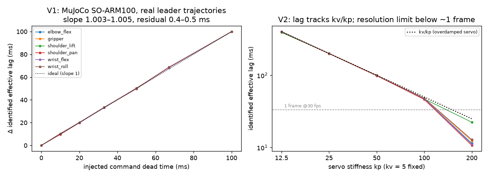

# demodyne — dynamics and data integrity from robot demonstration datasets

**Every leader–follower teleoperation dataset is an accidental system-identification
experiment.** It logs what each joint was *told* to do (`action`, the leader arm) and
what it *did* (`observation.state`, the follower arm), frame by frame. Thousands of
these datasets now sit on the Hugging Face Hub: ~4,000 tagged SO-100/SO-101 alone,
recorded on hundreds of physically different arms.

demodyne mines that signal. From the tabular data alone (no video, no hardware) it:

1. **identifies** a per-joint actuator model: dead time, time constant, effective lag, rate limit, deadband, steady offset, with bootstrap intervals;
2. **audits** datasets for bugs that leave every file well-formed but the physics impossible: states that move *before* their commands, swapped or sign-inverted channels, dead servos, stale sensor reads, single episodes recorded under different latency, "actions" that are really future states;
3. **checks whether datasets can be pooled** (`pool-check`): action/observation alignment and response lag measured in frames, plus unit and calibration-zero mismatches;
   and **fixes the alignment** (`realign`): writes a LeRobot copy whose action column is shifted to a common alignment;
4. **calibrates a MuJoCo arm** to a specific real arm by *fingerprint matching*: tune the simulated actuators until the simulator, run through the same identifier, produces the real arm's (L, T);
5. **runs fleet censuses** across hundreds of datasets for population-level actuator statistics and data-quality prevalence.

```
# analysis only (identify, audit, pool-check, realign)
pip install "git+https://github.com/shoggi211/demodyne"

# full checkout incl. MuJoCo experiments
git clone https://github.com/shoggi211/demodyne && cd demodyne
pip install -e ".[sim,test]"
git clone --depth 1 --filter=blob:none --sparse https://github.com/google-deepmind/mujoco_menagerie assets/menagerie
git -C assets/menagerie sparse-checkout set trs_so_arm100

demodyne report  lerobot/svla_so100_pickplace          # dynamics table + audit
demodyne audit   some-user/some_so101_dataset          # exit code 2 on errors (CI-friendly)
demodyne pool-check ds_a ds_b ds_c                     # can these be trained on together?
demodyne realign some-user/old_dataset -o ./aligned    # shift actions to the census record-loop alignment (+0.6 frames)
demodyne sim-params lerobot/svla_so100_pickplace       # MuJoCo kp/kv + command dead time
```

`<dataset>` is a Hub repo id or a local LeRobot directory (v2.0, v2.1 or v3.0 layout).
A web version for non-programmers lives in [`space/`](space/) (Hugging Face Space), and a
plain-language write-up of the findings is in [`docs/article.md`](docs/article.md).
Only `meta/info.json` and `data/**/*.parquet` are fetched.

---

## Why this matters

Robot-learning pipelines assume that an `(observation, action)` row means the same
thing in every dataset. The census below shows it does not:

* **Action/observation alignment is an unrecorded convention.** Datasets from the
  current LeRobot `record` loop (observe, then act) show positive apparent dead time.
  Older or custom pipelines show states moving one to two frames *before* the command
  that caused them. Pooled training (e.g. community-dataset pretraining) mixes action
  labels offset by up to ~60 ms for the same observation, and nothing in the metadata
  says so.
* **"The same robot" is not the same plant.** Effective command→response lag of
  nominally identical SO-100/101 arms spans a 2–3× range. Measurement repeatability is
  high (test–retest ICC 0.95–0.99), so the spread is real hardware/pipeline variation,
  not estimator noise. For a policy this means the same observation implies different
  future states. For simulation it means one actuator model cannot fit the fleet, and
  the census gives data-grounded domain-randomisation ranges.
* **Physics-level bugs are invisible to metadata linters.** Swapped motor IDs, inverted
  calibration, a torque-off servo or a shifted action column produce valid parquet with
  consistent `info.json`.

## How it works

**Model.** Each joint is a first-order-plus-dead-time (FOPDT) position tracker with rate limit, deadband and offset:

```
e[k]   = u(kh − L) − c − x[k]                       (fractional-delay command)
x[k+1] = x[k] + clip(a · dz(e[k], db), ±vmax·h),     a = 1 − exp(−h/T)
```

`L` and `T` are in seconds and **invariant to the joint's units** (degrees, radians,
normalized −100..100), so timing compares across datasets recorded under different
calibration conventions. `L + T` (the mean delay of the impulse response, the
*effective lag*) is the headline quantity. L and T individually trade off when both are
under two frames; their sum is well determined.

**Estimator.** Prediction-error method: a coarse-to-fine fractional-delay grid with
IRLS-Huber regression, then nonlinear least-squares refinement of (L, T, c, db, vmax)
with a soft-L1 loss, then an episode-level bootstrap of the full estimator.
Stall/contact segments (a gripper closed on an object, an arm pressing on the table)
are detected and excluded, and reported as their own signal.

**Audit checks.** `timing`, `stale_frames`, `frozen`, `mapping` (lagged
cross-correlation of command and state increments), `causality` (dataset-median dead
time < 0 or < −1.5 frames), `action_is_future_state`, `latency_outlier` (per-episode
lag against the dataset median), `stalls` (offset-aware), `idle`, `units`. Each check
has a known-truth fault injector in `demodyne.corrupt` for benchmarking.

**Fingerprint calibration** (`demodyne.calibrate`). Simulate the MuJoCo model under the
real recorded commands, identify the simulator with the *same* estimator, and update
`kv ← kv·(T_real/T_sim)^0.7` and `delay ← delay + 0.7·(L_real − L_sim)`, keeping the
best iterate per joint. Because both sides pass through one estimator, its biases
cancel (e.g. the apparent dead time a second-order plant shows at 30 fps).

---

## Validation

Everything below is reproducible from `experiments/`; raw results are in `experiments/results/`.

| # | Question | Setup | Result |
|---|---|---|---|
| unit tests | Exact recovery when the model is true | synthetic FOPDT data, encoder quantisation, noise | 21 tests pass (incl. realign round trips for v2/v3 layouts): L within 4 ms, T within 10%, timing unit-invariant (deg vs rad), stall-robust gripper fit, every fault type detected, no alarms on clean or slow-motion data |
| V1 | Does it recover *injected latency* on real physics? | MuJoCo Menagerie SO-ARM100 driven by **real leader trajectories**, 0–100 ms command dead time, 4096-tick encoder, noise | effective-lag slope **1.003–1.005**, residual **0.4–0.5 ms** on all 6 joints (frame period is 33 ms); dead-time slope 0.99–1.01 |
| V2 | Is T physically meaningful? | sweep servo stiffness kp 12.5→200 | Spearman(kp, T) = −1 on every joint; lag tracks **kv/kp** (overdamped servo theory). Resolution limit: true lag under ~1 frame (kp=200, 25 ms) is underestimated |
| V3 | Do the audits catch real-world faults on real data? | 12 **randomly selected** identifiable census datasets × 14 injected faults; a detection counts only if the finding is new relative to the dataset's clean audit | swaps 92–100%, sign inversions 100%, frozen servo 100%, stale frames (2%, 5%) 100%, dropped frames 100%, one episode +50 ms latency 100%, action column shifted −1/−2/−3 frames 100% (8/8 each; 4 datasets already carried an alignment warning and were excluded), future-state actions 100% |
| V5 | Does fingerprint calibration make MuJoCo match a real arm? | 12 real arms; calibrate on 10 episodes, replay 10 **held-out** leader trajectories, compare simulated vs real follower | improved 11/12, median **+9.8%**; arms >25 ms from the default model: **+28% to +49%** (n=4); arms near the default: +4.6%. Correlation with distance ρ=0.44, **p=0.15 (not significant at n=12)** |
| V8 | Does alignment matter for a learned policy, and does `realign` fix it? | MuJoCo SO-ARM100 target tracking; datasets A and B identical except B's action column is 0.5–3 frames stale; behaviour cloning on A, naive A+B, A+B re-aligned from **measured** alignment, oracle A+B; closed-loop eval on held-out targets, 5 seeds | correction recovered within 0.05 frames of the true shift; naive pooling degrades closed-loop tracking by +16% (1 frame) to +130% (3 frames) vs oracle and is **worse than using A alone** from 1 frame up; re-aligned pool matches the oracle (2.30–2.36° vs 2.31°) at every shift; no measurable effect at 0.5 frames |
| V7 | Is the fleet spread real or estimator noise? | odd vs even episodes of each census dataset | test–retest **ICC 0.95–0.99** per joint (n=34–41 arms); halves agree within ~2 ms vs between-arm SD 24–35 ms |

A side result from V5: demodyne's own per-joint FOPDT model predicts the held-out real follower
better than full MuJoCo physics on every arm tested (e.g. 0.28° vs 0.46° dynamic RMSE). For
latency-aware policy training or action-chunk timing, the lightweight model may be the more
useful artefact.



## Does alignment matter for learning? (V8)


A controlled simulation isolates label timing. Two 20-episode datasets come from the same
plant (MuJoCo SO-ARM100) and the same expert (a target-tracking operator that leads the target by
120 ms and corrects error with feedback). Dataset B's logger records the action *s* frames late,
the variation the census found between recording pipelines. A single-step MLP policy is trained
by behaviour cloning and evaluated closed-loop (observe→act at 30 fps) on 10 held-out targets.

| B staleness (frames) | naive pool A+B | re-aligned A+B | oracle A+B | A only |
|---|---|---|---|---|
| 0.5 | 2.27 ± 0.05° | 2.35 ± 0.04° | 2.31 ± 0.03° | 2.50 ± 0.12° |
| 1.0 | 2.67 ± 0.04° | 2.30 ± 0.03° | 〃 | 〃 |
| 1.5 | 3.26 ± 0.05° | 2.36 ± 0.03° | 〃 | 〃 |
| 2.0 | 3.93 ± 0.06° | 2.30 ± 0.04° | 〃 | 〃 |
| 3.0 | 5.32 ± 0.13° | 2.31 ± 0.04° | 〃 | 〃 |

Closed-loop tracking RMSE, mean ± SD over 5 training seeds. demodyne measured A at +0.60 frames,
and its corrections for B (+0.51, +0.98, +1.51, +1.97, +2.95) were within 0.05 frames of the
true shifts, with no ground truth used.

What this does and does not show:
* In this task, misaligned labels cost real performance from about one frame (33 ms) of
  staleness, and adding misaligned data is worse than not adding it. Re-alignment recovers
  oracle performance completely, because a pure label shift is exactly invertible once
  measured.
* The task was chosen to be timing-sensitive: the target moves, and the expert must lead it.
  Quasi-static tasks (slow pick-and-place) will be less sensitive. The size of the effect on
  real VLA/ACT training with action chunking is **not measured here**.
* The policy is a small single-step MLP; its absolute error (2.3°) is well above the expert's
  (0.48°). The comparison between conditions is the result, not the absolute numbers.
* `realign` fixes label *timing* only. Differences in arm response lag (finding 1 below) are
  hardware properties and remain after re-alignment; `pool-check` still reports them.

## Findings: census of 233 community SO-100/SO-101 datasets

Random sample of the 3,964 Hub datasets tagged `LeRobot` + `so100`/`so101` (250 sampled; 233
loadable). Up to 60 episodes each, parquet only. 182 have ≥3 identifiable arm joints.


**1. Nominally identical arms differ by more than 2× in response lag.** Per-dataset median
effective lag: p5 = 54 ms, p50 = 88 ms, p95 = 123 ms (p95/p5 = 2.3). Between-arm SD is 28 ms
against a within-dataset cross-joint SD of 10 ms and a test–retest difference of ~2 ms.
shoulder_lift, the gravity-loaded joint, is slowest (median 96 ms, p95 148 ms). The data gives
domain-randomisation ranges directly: e.g. wrist_flex lag p5–p95 = 52–122 ms.

**2. Action/observation alignment is an unrecorded convention that varies.** Median dead time
across joints, in frames:

| recording convention (by joint naming) | n | p10 / p50 / p90 (frames) | share with state *leading* command |
|---|---|---|---|
| `.pos` (current LeRobot `record`, observe→act) | 39 | −0.24 / +0.60 / +1.48 | 15% |
| `main_*` (legacy LeRobot) | 164 | −0.74 / +0.19 / +0.82 | 37% |
| other / custom pipelines | 19 | −1.32 / −0.96 / +0.49 | 63% |

28% of datasets get an alignment warning (state leads command by under 1.5 frames) and 5%
an error (beyond any loop-ordering convention). Pooling datasets therefore mixes action labels
whose timing relative to the observation differs by one to two frames.

**3. Physics-level defects that metadata linters cannot see** (share of 233 datasets):
held-off-command stalls on arm joints 15.9%, leader/follower range mismatch 7.3% (wrist_roll in
10 of 17), timing defects 4.3%, stale observation reads 3.0%, dead/unpowered servos 2.6%,
single-episode latency outliers 2.1%, actions derived from future states 1.7%, swapped channels
0.9% (2 datasets, unverified). **8.2% of datasets carry at least one error-level finding.**
Examples include a dataset named `…-multi-task-clean` whose wrist_roll follower covers 0.5% of
its commanded range across all episodes.

## Honest limitations

* **No hardware validation.** Ground truth comes from MuJoCo and injected faults. Real-arm
  claims rest on internal consistency (test–retest, held-out prediction), not bench
  measurement. A bench check against a real SO-101 with a known bus delay is the obvious next
  step.
* **"ms" means dataset time.** LeRobot timestamps are `frame_index / fps`. If a recording loop
  ran slower than its nominal fps, absolute lags are mis-scaled; lag *in frames* (what a policy
  sees) is unaffected. Part of the between-arm spread may be loop-rate variation, not servo
  hardware. The tool cannot currently separate the two.
* **Alignment verdicts are inferences.** Negative dead time is physically impossible only
  under observe-then-act. Under write-then-read, up to ~1 frame is legitimate, hence warning,
  not error, below 1.5 frames.
* **Model scope.** Position-controlled joints, leader-follower or policy-command datasets.
  End-effector/pose action spaces, torque control and mobile bases are out of scope (pose
  channels are skipped by the mapping check). The FOPDT model ignores pose-dependent gravity
  (shoulder_lift fits worst; its dead-time median is −13 ms, a sign of model mismatch, which is
  why alignment uses the median across joints).
* **Calibration study is small** (n=12) and fixes kp, so it cannot make a simulated arm
  faster than the plant's own apparent dead time. Fast arms are under-served.
* **Audit thresholds were tuned on this same corpus** after spot-checking real flags (frozen,
  stale-frame, stall and mapping rules were all tightened after false positives were found).
  Prevalence numbers are therefore in-sample. V3's fault set is synthetic, even though the
  backgrounds are real.
* `realign` recomputes action min/max/mean/std in `meta/stats.json` but leaves per-episode
  statistics in v3 `meta/episodes/` untouched (the shift changes them only marginally), and
  copies videos only with `--copy-videos`. It shifts the whole action vector by one
  dataset-level amount; per-joint or per-episode misalignment is not corrected.
* Census covers one robot family (SO-100/101). ALOHA/Koch/Franka datasets load, but were not
  studied.

## Novelty: what exists and what is new here

* **Exists:** metadata/format linters for LeRobot datasets (trajlens and others); per-robot
  sysid toolkits that need excitation experiments or a simulator in the loop (FIGAROH,
  mujoco-sysid, the Isaac Sim sysid extension); a single-arm, single-dataset fit of SO-101
  servo gains by MuJoCo replay (blog, Aug 2026); policy-dependent data-curation methods
  (DemInf, CUPID, Demo-SCORE).
* **New, to my knowledge:** (1) treating public teleop corpora as a fleet-scale actuator
  identification experiment, with population statistics across ~180 arms; (2) physics-level
  audits (causality, mapping, stale reads, latency outliers) that need no policy and no
  metadata, with a known-truth fault injector; (3) measuring action/observation alignment from
  data and showing it varies by recording pipeline; (4) fingerprint-matching calibration of a
  simulator through the identifier itself. I did not find these in the literature or tooling
  surveyed (six parallel searches plus targeted queries), but absence of evidence is not proof.

## Layout

```
src/demodyne/
  model.py      FOPDT servo model (fractional delay, deadband, rate limit)
  ident.py      robust prediction-error identification, stall exclusion, bootstrap
  audit.py      physics-level checks
  corrupt.py    known-truth fault injection (benchmarking validators)
  pool.py       pre-pooling compatibility check
  realign.py    shift a dataset's actions to a target alignment (writes LeRobot copy)
  sim.py        MuJoCo ground-truth generator + closed-loop policy rollout (Menagerie SO-ARM100)
  calibrate.py  fingerprint-matching simulator calibration
  fleet.py      Hub discovery, census runner, population statistics
  io.py         LeRobot v2.0/2.1/3.0 loader (parquet only, rate-limit aware)
  cli.py        `demodyne` command
experiments/    V1–V8 scripts and results
tests/          unit tests (pytest)
```

The MuJoCo model is fetched from `google-deepmind/mujoco_menagerie` (`trs_so_arm100`) into
`assets/menagerie/`. Set `HF_TOKEN` to raise Hub rate limits for census runs.
