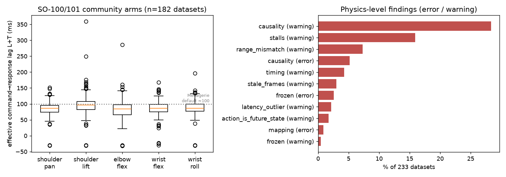
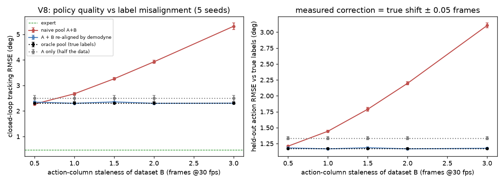

# The same robot arm, recorded 233 different ways

*An audit of public robot-training datasets finds that "identical" arms behave very differently,
that recordings disagree about timing, and that about one dataset in twelve has a hidden physical
defect.*

| 233 | 2.3× | 1 in 12 | +130% |
|---|---|---|---|
| community SO-100/101 datasets analysed | spread in reaction time between nominally identical arms | datasets with a serious hidden defect | worse robot control when out-of-sync data is mixed in (simulation) |

## How robots learn from people

A popular way to teach a robot arm a task is to show it. A person moves a *leader* arm by hand, a
second *follower* arm copies every motion, and a computer records both, along with camera images,
about 30 times per second. A neural network then learns to map what the robot sees to what it
should do.

Thousands of these recordings are shared publicly on the Hugging Face Hub, around four thousand
for one low-cost arm design (the SO-100 and SO-101) alone. Researchers routinely pool hundreds of
them to train general-purpose robot models. That assumes every recording means the same thing. We
checked whether it does.

> **The key idea.** Each recording contains both what the arm was *told* to do (the leader) and
> what it *actually did* (the follower). Comparing the two frame by frame works like timing
> someone's reflexes from video of them catching balls. It reveals how fast this particular arm
> reacts, and it exposes recordings where the two streams cannot both be true.

We built an open-source tool, [demodyne](https://github.com/shoggi211/demodyne), that does this
comparison using only the numbers in the files. It needs no robot and no video. We checked its
accuracy in a physics simulator first: when we added known delays, it measured them to within half
a millisecond, though a single camera frame lasts 33.

## Finding 1: identical arms are not identical

Across the arms we could measure, the time from command to movement ranged from about 54 ms to
123 ms (5th to 95th percentile), with a median of 88 ms. Measuring two halves of the same dataset
separately gives answers within about 2 ms of each other, so the spread is real and not noise. It
comes from differences in motors, wiring, power supplies and recording software.

This matters in two places. A robot model trained on pooled data sees the same situation lead to
different outcomes, depending on whose arm recorded it. And robot simulators usually assume one
fixed motor model, which cannot match the whole fleet.



## Finding 2: recordings disagree about timing

Each row in a dataset pairs an observation with an action. Whether the action belongs to the same
instant, or to a moment before or after, depends on the software that recorded it, and nothing in
the files says which. Datasets from the current official recording program behave consistently.
Older and custom pipelines often record actions one to two frames late, so the robot appears to
move *before* it was told to.

28% of datasets were measurably out of step with the current convention, and 5% were off by more
than any recording-order effect could explain.

### Does this hurt the robot?

We tested it in simulation. Two datasets were recorded on the same simulated arm by the same
scripted operator; the only difference was that one logged its actions a little late. We trained a
robot controller on different mixes and measured how well it tracked a moving target.

| How late the second dataset's actions were | Mixed as-is | Mixed after demodyne's fix | Perfect labels |
|---|---|---|---|
| 1 frame (33 ms) | 2.67° | 2.30° | 2.31° |
| 2 frames | 3.93° | 2.30° | 2.31° |
| 3 frames | 5.32° | 2.31° | 2.31° |

Numbers are tracking error (lower is better), averaged over five training runs. From one frame of
offset onward, adding the mismatched data made the controller *worse than not adding it at all*.
Measuring the offset and shifting the data back restored full performance. The tool estimated each
offset to within 0.05 frames without being told the answer.



## Finding 3: physical defects that file checkers cannot see

Existing validators check that a dataset's files agree with each other. These problems leave every
file well-formed:

- **2.6%**: motors that never moved while commanded (switched off or unplugged), including a dataset named "…-clean" whose wrist barely moved in any episode
- **7.3%**: follower arms reaching only part of the commanded range, usually the wrist rotation joint, which points to calibration that differs between the two arms
- **3.0%**: sensor readings that freeze for a single frame in the middle of fast motion, which a real arm cannot do
- **2.1%**: individual episodes recorded with a noticeably different delay from the rest
- **1.7%**: "actions" that are really copies of later positions rather than commands

In total, 8.2% of datasets carried at least one error-level problem.

## What we have not shown

- We have not tested on a physical robot. The accuracy checks use a physics simulator and deliberately planted faults; the real-data findings rest on consistency checks.
- LeRobot timestamps are computed from frame numbers rather than a real clock. A recording that ran slower than advertised would make its millisecond figures inaccurate, although its timing in frames, which is what a robot model experiences, is still correct.
- The training experiment uses a small controller on a deliberately timing-sensitive task. Its effect on large commercial-scale robot models is untested.
- Our detection rules were refined on this same collection of datasets, so the percentages are best read as estimates.

## Try it

```
pip install "git+https://github.com/shoggi211/demodyne"
demodyne report  lerobot/svla_so100_pickplace     # health report
demodyne pool-check dataset_a dataset_b           # safe to combine?
demodyne realign old_dataset -o ./fixed           # repair timing
```

**Have an SO-100 or SO-101 arm?** The most useful next step is a check on real hardware. If you can
record a short session and run the tool on it, please share the result through the project's
[issue tracker](https://github.com/shoggi211/demodyne/issues). If the tool flagged one of your
datasets, we would like to know whether it was right.
